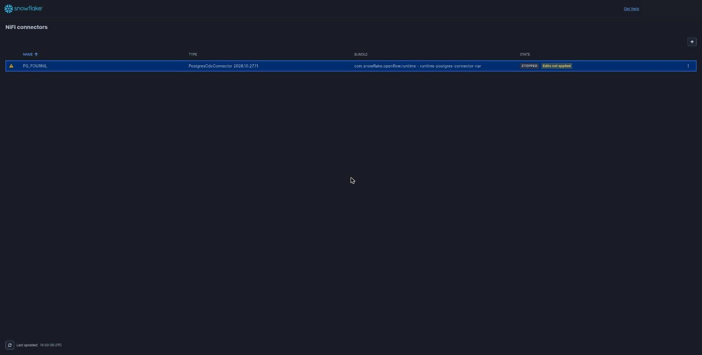
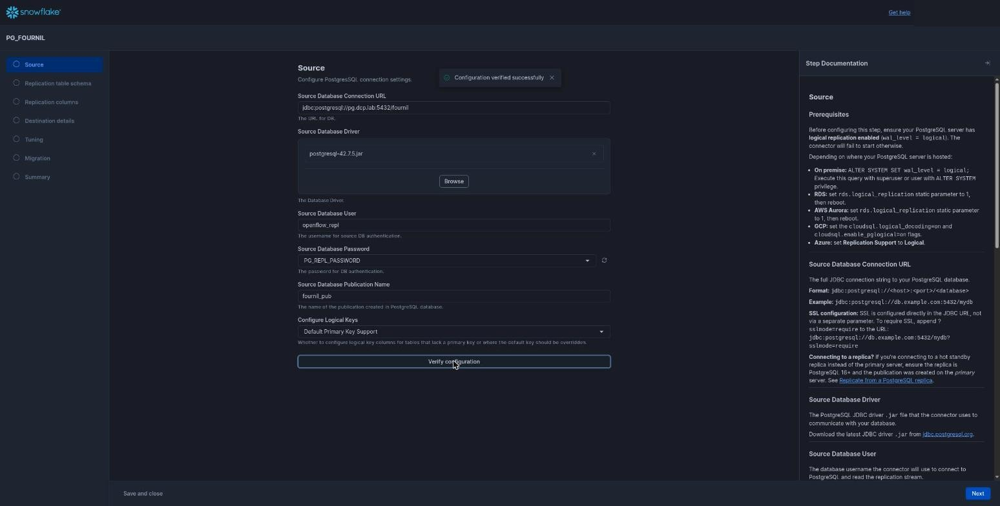
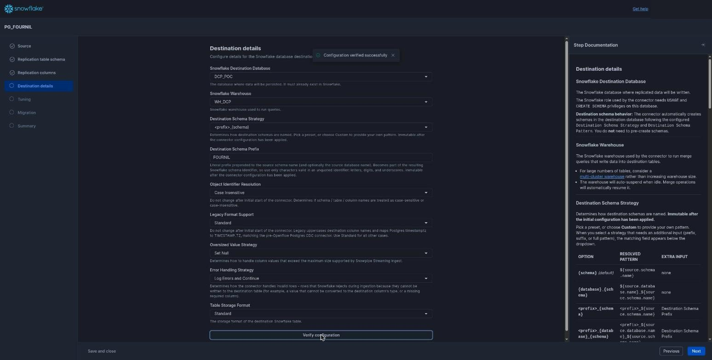
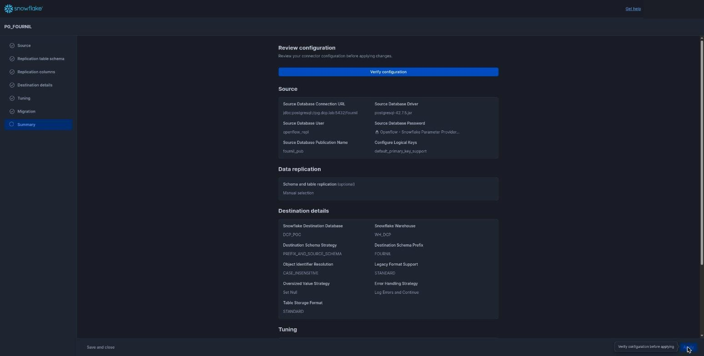
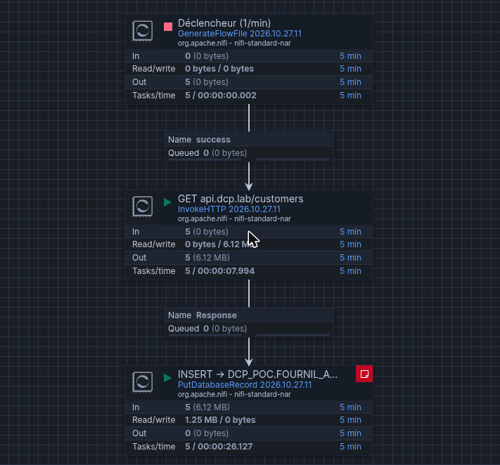

# Snowflake Data Connectivity Proxy : j'ai branché ma base locale à Snowflake sans ouvrir un seul port

*Brouillon, rédigé au fil du POC. Toutes les données sont fictives ; le code est sur GitHub (lien à venir).*

## Le problème : faire venir Snowflake chez soi

Une base Postgres dans un datacenter, une API métier derrière un pare-feu : dès qu'on veut les atteindre depuis Snowflake, les options classiques font grincer des dents.

- **PrivateLink / Private Service Connect** : propre, mais réservé à l'édition Business Critical et limité au cloud du compte.
- **IP de sortie fixes de Snowflake** : on ouvre un port entrant filtré par IP. C'est toujours une ouverture, et les équipes sécurité n'aiment pas ça.

**Data Connectivity Proxy (DCP)** inverse le sens : un petit agent, installé à côté de la source, ouvre **une connexion sortante** (TLS, port 443) vers Snowflake. Snowflake fait ensuite passer ses connexions dans ce tunnel. Il n'y a ni port entrant, ni IP publique, ni VPN. DCP est disponible en Standard, Enterprise et Business Critical, sur AWS, Azure et GCP.

Petit bémol dans la doc : *« DCP is available for use with Snowflake Openflow »*. Openflow, et rien d'autre ? Le routage passe pourtant par une **External Access Integration**, l'objet qu'utilisent aussi les procédures et fonctions Python. J'ai donc voulu vérifier si une simple procédure Python pouvait profiter du tunnel.

## Le banc de test

```
 Snowflake (AWS us-west-2)                          Mon poste (Docker)
 ┌───────────────────────────┐                      ┌───────────────────────────────┐
 │ CALL PG_QUERY(...)        │                      │  dcp-agent ──► pg.dcp.lab:5432 │
 │ SELECT API_GET(...)       │                      │      │     └─► api.dcp.lab:8000 │
 │   └─ EAI DCP_LAB_EAI      │   tunnel TLS 443     │      │                         │
 │       └─ relais DCP ◄─────┼──────────────────────┼──────┘  (connexion SORTANTE)   │
 └───────────────────────────┘                      └───────────────────────────────┘
```

- **Côté source** : un `docker compose` avec Postgres 17, contenant les données d'une chaîne de boulangeries fictive, « Fournil & Co » (10 000 clients, 1 000 000 de commandes générées en SQL avec une graine fixe), et une petite API FastAPI.
- **L'agent** : l'image `snowflakedb/dcp-client` dans le même réseau Docker. Il est le seul à connaître `pg.dcp.lab` et `api.dcp.lab`.
- **Côté Snowflake** : une procédure Python (psycopg2) et une UDF Python (requests). Leur code n'a **rien de spécifique à DCP**.

## Étape 1 : un socle Snowflake en 5 minutes avec DCM

Pour ne pas bricoler à la main, le socle (warehouse, base, schémas, rôle de test) est décrit en SQL déclaratif avec **DCM** (Database Change Management) :

```sql
define warehouse {{warehouse}}
with warehouse_size = '{{wh_size}}' auto_suspend = {{auto_suspend}} initially_suspended = TRUE;

define database {{database}} data_retention_time_in_days = {{data_retention_days}};
```

`make bootstrap create plan deploy` : le plan annonce 8 entités, le déploiement suit. Les objets DCP, eux, restent **hors DCM** : ce sont des objets de niveau compte, tout récents.

## Étape 2 : créer le proxy, et attendre

```sql
create data connectivity proxy DCP_LOCAL;
select SYSTEM$ISSUE_PER_ACCOUNT_CERTIFICATES();   -- « Certificates will be issued. »
```

Deux pièges :

1. **Le proxy est créé désactivé** (`enabled = false`). Il faut `ENABLED = TRUE` à la création, ou un `ALTER` ensuite.
2. **Les certificats du compte sont émis de façon asynchrone** : la première fois, il faut attendre au moins 30 minutes avant de démarrer l'agent.

Pendant ce temps, on déclare ce que le tunnel a le droit de joindre. On utilise une règle réseau d'un **mode dédié**, attachée à une EAI elle-même associée au proxy :

```sql
create network rule NR_DCP_LAB
  mode = DATA_CONNECTIVITY_PROXY_EGRESS        -- et non EGRESS
  type = HOST_PORT
  value_list = ('pg.dcp.lab:5432', 'api.dcp.lab:8000');

create external access integration DCP_LAB_EAI
  allowed_network_rules = (NR_DCP_LAB) allowed_authentication_secrets = all enabled = true;

alter data connectivity proxy DCP_LOCAL set external_access_integrations = (DCP_LAB_EAI);
```

Les noms sont des noms DNS **résolus par l'agent**, pas par Snowflake. Ici, ce sont des alias de réseau Docker.

## Étape 3 : une procédure Python tout à fait ordinaire

```python
def run(session, query):
    cred = _snowflake.get_username_password('pg')
    with psycopg2.connect(host='pg.dcp.lab', port=5432, dbname='fournil',
                          user=cred.username, password=cred.password) as conn:
        ...
```

Le seul élément propre à DCP est la clause `external_access_integrations = (DCP_LAB_EAI)`.

Premier appel, **avant même de démarrer l'agent** :

```
509003 (22023): Domain 'pg.dcp.lab' is not reachable.
```

C'est déjà une bonne nouvelle : Snowflake accepte une procédure Python sur une EAI en mode DCP et aiguille son trafic vers le proxy. Il ne manque que l'agent.

## Étape 4 : l'agent, puis la douche froide

```sh
docker run -d --name dcp-agent --restart unless-stopped \
  -v ./secrets/dcp-bootstrap-token:/etc/dcp-agent/secrets/dcp-bootstrap-token:ro \
  -e DCP_METRICS_PORT=9092 snowflakedb/dcp-client:2026.10.23.1
```

Côté agent, tout va bien : en moins de 20 secondes, `DESCRIBE DATA CONNECTIVITY PROXY` affiche `HEALTHY`, `DCP_AGENT_LIFECYCLE_CONNECTED` et `DATA_PATH_HEALTHY`. `reachable_destinations` liste bien `pg.dcp.lab:5432` et `api.dcp.lab:8000`. On a là une installation réellement simple : une image de 12 Mo, un fichier de token, rien d'autre.

Côté procédure Python, en revanche : toujours `Domain 'pg.dcp.lab' is not reachable`, même une heure plus tard. La fonction de diagnostic `DCP_CLIENT_ROUTE_CHECK` valide 6 étapes sur 8 et reste en attente sur les deux dernières : *« no connections from this client have been observed »*. L'historique `DCP_CLIENT_CONNECTION_HISTORY` est vide. Rien n'est jamais arrivé dans le tunnel.

Deux expériences ont permis de comprendre :

1. **Un nom qui se résout publiquement.** `*.localtest.me` répond 127.0.0.1 sur Internet ; côté agent, ces noms sont des alias Docker. Le résultat est le même échec. Surtout, l'erreur cite toujours **la première entrée de la règle réseau**, même quand on appelle l'autre. Snowflake teste donc toutes les destinations au démarrage du sandbox Python, lui-même, sans passer par l'agent.
2. **Un hôte public dans une règle DCP.** Avec `httpbin.org:443` dans une règle `DATA_CONNECTIVITY_PROXY_EGRESS`, l'appel **réussit**. Mais l'IP d'origine renvoyée par httpbin est une IP AWS de Snowflake, pas celle de mon poste, et les compteurs de connexions de l'agent restent à 0.

**Verdict de l'expérience : aujourd'hui, depuis une UDF ou une procédure Python, une règle DCP se comporte comme une règle de sortie ordinaire. Le trafic sort directement de Snowflake et le tunnel n'est jamais emprunté.** La doc ne mentait pas : DCP est *« available for use with Snowflake Openflow »*. Snowflake accepte pourtant sans broncher toute la chaîne (règle DCP, EAI, procédure Python), et on ne s'aperçoit du problème qu'à l'exécution.

Au passage, un point de sécurité : une règle « DCP » ouvre bel et bien une sortie Internet publique aux fonctions Python qui l'utilisent.

## Étape 5 : le chemin officiel, Openflow

Puisque DCP est fait pour Openflow, on rejoue l'exercice avec **Openflow gen 2**, déployé dans Snowflake (SPCS). Bonne surprise : gen 2 se pilote presque entièrement en SQL.

```sql
create openflow deployment DCP_DEPLOYMENT deployment_type = SNOWFLAKE;      -- ~9 min avant ACTIVE

create openflow runtime DCP_RT in deployment DCP_DEPLOYMENT
  node_type = MEDIUM min_nodes = 1 max_nodes = 1
  execute_as_role = OPENFLOW_DCP_RT_EXECUTE_AS_RL
  external_access_integrations = (DCP_LAB_EAI);                             -- ~4 min, la même EAI qu'avant

create openflow connector PG_FOURNIL in runtime DCP_RT from definition OPENFLOW_POSTGRES_CDC;
```

Côté Postgres, rien d'exotique pour de la CDC : `wal_level = logical`, une publication et un utilisateur doté de l'attribut `REPLICATION`.

Le connecteur créé en SQL apparaît dans l'interface Openflow, arrêté, en attente de configuration :



Le paramétrage du connecteur, lui, passe une première fois par l'assistant web : c'est là qu'on téléverse le driver JDBC, et la doc conseille de récupérer ensuite le `config.json` généré pour industrialiser. Deux pièges en chemin :

- **un utilisateur dont le rôle par défaut est ACCOUNTADMIN ne peut pas se connecter** à l'interface Openflow (« The role requested has been explicitly blocked for use with this application »). Il faut changer le rôle par défaut, au moins le temps de la configuration ;
- la stratégie de schéma par défaut écrit dans un schéma nommé comme la source (`PUBLIC`), qui existe déjà dans toute base Snowflake. Un préfixe (`FOURNIL_PUBLIC`) évite les conflits de droits.



Et là, enfin : **« Configuration verified successfully »**. Côté agent, les journaux montrent les premières connexions vers `pg.dcp.lab:5432` (handshake de 2 ms), et les compteurs passent à `agent_connections_total{status="ok"} = 3`. L'assistant liste même les schémas et tables de la base locale, en direct à travers le tunnel. La configuration de la connexion se résume à une URL JDBC tout à fait banale : `jdbc:postgresql://pg.dcp.lab:5432/fournil`.

Côté destination, on choisit la base, le warehouse qui exécute les merges, et la stratégie de nommage des schémas, ici avec le préfixe `FOURNIL` :



Le récapitulatif avant application ; chaque étape est revérifiée, toujours à travers le tunnel :



Une fois appliquée, la configuration se télécharge (`GET snow://openflow_connector/.../config.json`) et se versionne : elle ne contient aucun secret, seulement des références (`SECRET_REFERENCE` pour le mot de passe, `ASSET_REFERENCE` pour le driver). Au démarrage du connecteur, le snapshot initial d'un million de lignes commence, puis la CDC prend le relais.

## Étape 6 : et une API REST ?

DCP transporte du TCP : rien ne le limite aux bases de données. Mais le catalogue Openflow ne propose pas de connecteur « API REST générique ». On construit donc un flux à la main dans le canevas NiFi du runtime : trois processeurs standards.



1. `GenerateFlowFile` : un déclencheur, une fois par minute ;
2. `InvokeHTTP` : `GET http://api.dcp.lab:8000/customers?limit=10000`, en HTTP clair, puisque c'est le tunnel qui chiffre ;
3. `PutDatabaseRecord` : un lecteur JSON et le `SnowflakeConnectionService` d'Openflow en mode `SNOWFLAKE_MANAGED`, donc sans clé ni mot de passe. Il écrit dans `DCP_POC.FOURNIL_API.CUSTOMERS`.

La définition du flux est exportée en JSON dans le repo (`openflow/api_rest_fournil_flow.json`) : elle se réimporte telle quelle dans n'importe quel canevas Openflow.

Rien de propre à DCP dans ce flux : `api.dcp.lab:8000` figurait déjà dans la règle réseau, et l'EAI était déjà rattachée au runtime. **10 000 clients chargés, 0 doublon.** L'appel HTTP prend **1,6 s pour 1,28 Mo, soit environ 800 Ko/s** à travers le tunnel, 18 fois le débit du snapshot Postgres. Le tunnel n'est donc pas ce qui ralentissait le snapshot.

Deux pièges, sans rapport avec DCP, mais qui coûtent une demi-heure :

- le lecteur JSON lit les dates ISO 8601 comme des chaînes, tant qu'on ne lui donne pas un « Timestamp Format » ;
- **le driver JDBC Snowflake ne sait pas lier le type `TIMESTAMP_WITH_TIMEZONE`** (*« Data type not supported for binding: 2,014 »*). Il faut une colonne `TIMESTAMP_NTZ`, et surveiller le fuseau de session : on a observé un décalage d'une heure.

## Performance

Le banc tourne sur un poste en France ; le compte Snowflake est en AWS us-west-2. Chaque octet fait donc l'aller-retour transatlantique via le relais DCP.

| Mesure | Résultat |
|---|---|
| Démarrage de l'agent jusqu'à HEALTHY | < 20 s |
| Déploiement Openflow (SPCS) jusqu'à ACTIVE | ~9 min, plus ~4 min pour le runtime |
| **Snapshot initial, 1 000 000 de lignes** | **30 min 12 s**, ~550 lignes/s, **~44 Ko/s parfaitement constants** |
| **CDC, 200 000 lignes insérées** | **104 s**, ~1 900 lignes/s, ~214 Ko/s |
| CDC, même test avec +200 ms de latence (netem) | 102 s : aucune différence |
| Latence CDC de bout en bout (100 lignes) | 42 à 91 s, dominée par le merge planifié chaque minute |
| Appel HTTP de l'API locale via Openflow (1,28 Mo) | 1,6 s, ~800 Ko/s |

Deux enseignements :

- **Le snapshot est lent, et étrangement plat.** 44 Ko/s pendant 30 minutes, sur une poignée de connexions longues. Le profil évoque une lecture par lots où chaque lot paie un aller-retour complet (France → relais → us-west-2). Ce n'est en tout cas pas la bande passante du tunnel : le même tunnel transporte une réponse HTTP à ~800 Ko/s, 18 fois plus vite. Pour une base de plusieurs dizaines de Go, il faudra planifier le chargement initial, ou rapprocher le compte de la source.
- **La CDC, elle, ne souffre pas du tunnel.** Le flux WAL est continu, 5 fois plus rapide que le snapshot, et insensible à 200 ms de latence ajoutée. La fraîcheur est pilotée par le cron de merge, pas par DCP.

## Et quand le réseau coupe ?

Deux scénarios sur le flux CDC en marche, avec à chaque fois 1 000 commandes insérées *pendant* la coupure :

| Scénario | Ce que montre Snowflake | Retour à HEALTHY | Toutes les lignes visibles | Pertes / doublons |
|---|---|---|---|---|
| Agent tué (`docker kill`), 2 min | HEALTHY encore ~1 min, puis **DOWN** | 73 s | **131 s** après le redémarrage | **0 / 0** |
| Lien Internet de l'agent coupé, ~3,5 min | **DEGRADED / DATA_PATH_FAILED** | 84 s | **140 s** après le rétablissement | **0 / 0** |

La bonne nouvelle : **aucune perte, aucun doublon**. Le slot de réplication Postgres conserve le WAL ; le connecteur reprend là où il s'était arrêté dès que le tunnel revient, sans intervention.

La moins bonne : **le connecteur reste RUNNING pendant toute la coupure**, sans erreur visible à son niveau. Il faut donc superviser le proxy (`DESCRIBE DATA CONNECTIVITY PROXY`, ou les métriques Prometheus de l'agent sur `:9092`), pas seulement le connecteur. Et la détection prend environ une minute, le temps du keepalive.

## Sécurité et limites

**Ce qui rassure**

- **Aucun port entrant.** Le poste ne publie rien. L'agent ouvre des connexions TLS sortantes sur 443 et rien d'autre.
- **Le filtrage est côté Snowflake, à l'hôte et au port près.** `DCP_CLIENT_ROUTE_CHECK` refuse `pg.dcp.lab:22` ou `example.com:443` (`DCP_POLICY_DESTINATION_NOT_PERMITTED`), même si l'agent pourrait techniquement les joindre. L'agent n'est pas une porte ouverte sur tout son réseau.
- **Le jeton d'amorçage porte l'identité *et* l'adresse du plan de contrôle.** Un jeton `PAT_` ou un JWT forgé est refusé avant toute connexion. Sa rotation se fait en remplaçant un fichier, sans redémarrage.
- **Les identifiants des sources restent dans Snowflake** (secrets). L'agent ne voit passer que des octets chiffrés.

**Ce qu'il faut savoir**

- **Openflow uniquement, pour de vrai.** Depuis une UDF ou une procédure Python, une règle `DATA_CONNECTIVITY_PROXY_EGRESS` est acceptée sans broncher, mais se comporte comme une sortie Internet ordinaire. Le tunnel n'est jamais emprunté, et un hôte public listé dans une règle « DCP » devient joignable en direct.
- **Supervision.** Pendant une coupure, le connecteur Openflow reste `RUNNING`. Seul le proxy (`DESCRIBE DATA CONNECTIVITY PROXY`, métriques Prometheus de l'agent) dit la vérité, avec environ une minute de retard.
- **Pas de haute disponibilité active-active.** La doc recommande deux agents dans des domaines de panne distincts, mais sans équilibrage de charge pour une même destination.
- **Mise en route lente la première fois** : 30 minutes d'attente pour les certificats du compte, 9 minutes pour le déploiement Openflow, 4 pour le runtime.
- **Petits pièges** : proxy créé désactivé, noms DNS obligatoirement qualifiés (avec un point), interface Openflow interdite aux utilisateurs dont le rôle par défaut est ACCOUNTADMIN.
- **Coût** : DCP lui-même n'apparaît pas dans la facturation de ce test. C'est Openflow qui coûte : environ 0,35 crédit/h pour un nœud MEDIUM, plus environ 0,1 crédit/h de pool de contrôle, qu'il tourne ou non.

## Verdict

**Pour Openflow, DCP tient ses promesses.** En une heure de configuration, une base Postgres et une API REST sur un poste, sans IP publique ni port ouvert, alimentent Snowflake en CDC. On n'écrit pas une ligne de réseau dans les connecteurs : une URL JDBC et une URL HTTP tout à fait banales. Les coupures se rattrapent seules, sans perte ni doublon.

**Pour le reste de Snowflake, pas encore.** Ceux qui espéraient brancher une UDF Python ou une procédure sur leur SI via DCP en seront pour leurs frais : le chemin n'existe pas aujourd'hui, et rien ne vous le dit à la création des objets.

**Les points à surveiller** : un snapshot initial lent (44 Ko/s ici, sur un trajet transatlantique), une supervision à porter sur le proxy plutôt que sur le connecteur, et le coût fixe d'un runtime Openflow.

Pour un premier cas d'usage « CDC d'une base on-premise sans ouvrir le pare-feu », c'est probablement aujourd'hui la solution la plus simple de l'écosystème Snowflake.

*Le code complet du banc de test (DCM, Docker Compose, scripts de mesure et de coupure) est sur GitHub : lien à venir.*
